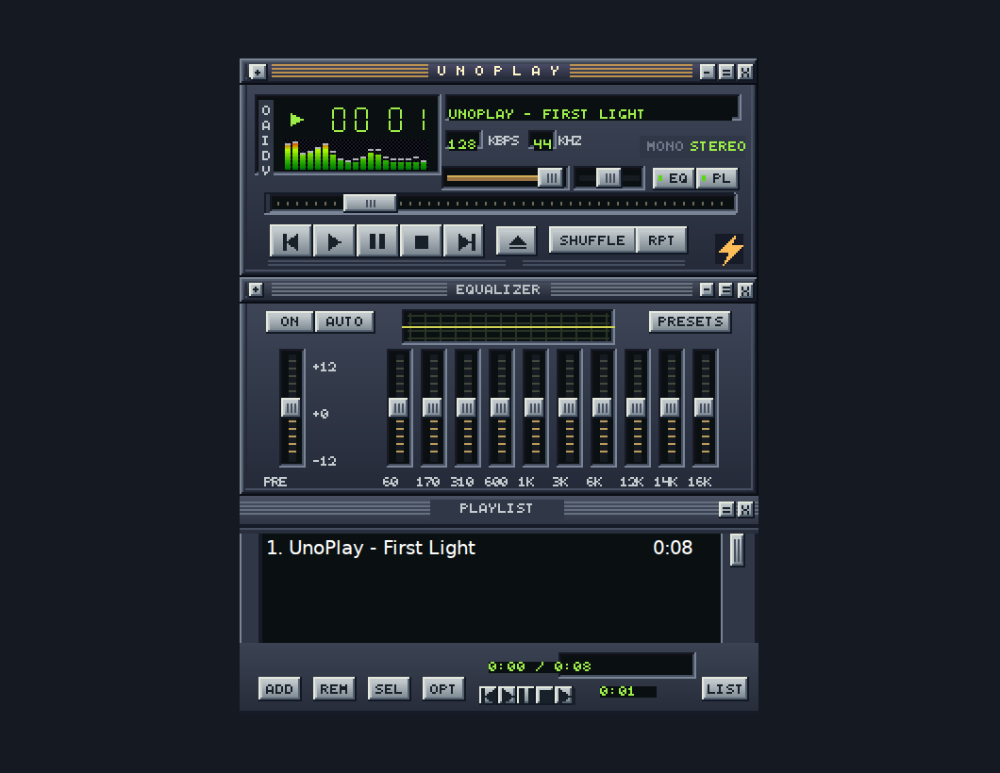

# UnoPlay

[Play UnoPlay in the browser](https://wieslawsoltes.github.io/UnoPlay/) · [Download a desktop build](https://github.com/wieslawsoltes/UnoPlay/actions/workflows/desktop.yml)

UnoPlay is a C# media player built with Uno Platform for WebAssembly and Skia Desktop. Press **Play** to hear *First Light*, a short original stereo track included with the app. Use the top-left menu to open a media URL, playlist, or classic Winamp skin. You can also drop files onto the workspace.



## Classic workspace

The main player, ten-band equalizer, playlist editor, and video window use the active skin’s bitmap sheets. The renderer slices sprites in classic skin coordinates and caches the cells for reuse. The bundled Midnight skin and its pixel font are original artwork. The skin source and the demo synthesizer are included in the repository.

- Load a classic `.wsz` or zipped skin. The importer handles nested directories, case-insensitive names, indexed and true-color bitmaps, RLE, bitfields, playlist fonts and colors, visualization palettes, window regions, and fallback artwork.
- Drag the title bars to move and dock the panels. Double-click a title bar for windowshade. The playlist grip resizes the editor. The main window menu can arrange the windows again.
- Use the playlist editor to add files and locations, select, reorder, sort, remove, jump to a track, and import or export playlists. Shuffle tracks retain back/forward history.
- Set preamp, balance, and individual band gains. Choose a factory preset or import Winamp EQF/Q1/Q2 preset banks. Export the current equalizer configuration as an EQF.
- Open the searchable Media Library using **Alt+L**, or the skinned MiniBrowser using **Alt+B**. The browser opens a page when you enter its HTTP(S) address.
- Right-click the visualization to choose spectrum or oscilloscope modes, bar style, peak indicators, bandwidth, and falloff. The visualizers read actual output samples when the active backend provides them.

| Shortcut | Action |
| --- | --- |
| Z / X / C / V / B | Previous / play / pause or resume / stop / next |
| L / Ctrl+L | Open media files / open URL |
| J | Jump to a track |
| Alt+L / Alt+B | Media Library / MiniBrowser |
| F11 | Toggle video fullscreen |
| R / S | Repeat / shuffle |
| Left / Right | Seek five seconds |
| Up / Down | Adjust volume |
| Ctrl+E / Ctrl+P / Ctrl+D | Toggle equalizer / playlist / double size |

## Media backends

| Source | Browser | Desktop |
| --- | --- | --- |
| Local MP3 | HTML media, Web Audio, zero-copy browser file URLs | SoundFlow streaming decoder, ten-band DSP, stereo balance and analyzer |
| Local FLAC and WAV | Browser codecs and Web Audio | Same native DSP path as MP3 |
| MP4 video | HTML video and installed browser codecs | Uno MediaPlayerElement and the platform media backend |
| HTTP(S) media and radio | Browser media element. Servers allowing cross-origin audio analysis can use Web Audio | Windows and Linux send recognized audio streams through libVLC, the ten-band EQ, balance and analyzer. macOS and unclassified media use the Uno transport |
| HLS | Native HLS where available, lazy-loaded hls.js for compatible Media Source Extensions browsers | Available formats depend on the platform media backend |
| M3U / M3U8 / PLS track lists | Relative media URLs resolve against the playlist address | Local paths and remote URLs |

For cross-origin radio without CORS permission, UnoPlay retries direct media playback. That browser security boundary disables sample access for EQ, balance and visualization. Desktop video and the macOS network transport use Uno’s platform decoder. Windows and Linux recognize audio file extensions and probe ambiguous radio URLs for an audio MIME type. A bounded 250 ms stereo PCM buffer feeds the audio device without waiting for the network on its render thread. Audio/video codecs depend on the browser or installed native components.

## Build and run

Install .NET 10. The repository pins Uno.Sdk 6.7.30 in `global.json`.

```sh
dotnet run --project src/UnoPlay.App -f net10.0-desktop -p:UnoPlayTarget=net10.0-desktop
dotnet run --project src/UnoPlay.App -f net10.0-browserwasm -p:UnoPlayTarget=net10.0-browserwasm
dotnet publish src/UnoPlay.App -c Release -f net10.0-browserwasm -p:UnoPlayTarget=net10.0-browserwasm -o artifacts/publish
python3 -m http.server 8000 --directory artifacts/publish/wwwroot
```

Linux desktop uses X11 or XWayland. For native video and network playback on Ubuntu, install `libvlc-dev vlc-plugin-base vlc-plugin-video-output`. The native loader uses the unversioned `libvlc.so` provided by the development package. Linux self-contained builds include the .NET runtime and the local audio decoder. The optional Linux MiniBrowser uses GTK 3 and WebKitGTK 4.1. Windows and macOS use the corresponding Uno desktop host.

The desktop workflow produces separate self-contained Windows x64, Linux x64, and macOS Apple Silicon packages. Download the artifact for your OS from a successful workflow run. Extract the archive, then start `UnoPlay.App` or `UnoPlay.App.exe`.

## Reusable libraries

| Project | Responsibility |
| --- | --- |
| `UnoPlay.Core` | Queue identity and shuffle navigation, M3U/PLS, remote playlist resolution and Winamp equalizer files |
| `UnoPlay.ClassicSkins` | Bounded archive reader, BMP decoder, skin metadata, polygon masks and bundled artwork |
| `UnoPlay.Metadata` | Bounded metadata probes for file streams and HTTP ranges, including ID3 and MP4 atoms |
| `UnoPlay.Media` | Transport, browser HTML media and Web Audio graph, desktop playback, spectrum and waveform sampling |
| `UnoPlay.ClassicUI` | Embeddable player workspace, classic rendering, hit testing, gestures, file pickers and settings |
| `UnoPlay.App` | Browser and desktop entry points |

Embed `new ClassicPlayerView()` in a Uno window, or pass your own `PlayerEngine` and `PlayQueue`. Call `RestorePreferencesAsync()` to opt in to persistence. Call `Shutdown()` when permanently removing the view. The host retains ownership of any engine it supplies.

## Compatibility and verification

The portable test executables cover skin formats, queue editing, equalizer files and metadata. `tests/browser/app.cjs` targets the published app mounted under `/UnoPlay/`. `tests/media/playback.cjs` generates real MP3, MP4 and HLS fixtures with ffmpeg and tests decoding, DSP, fallback and cleanup in Chromium. `tests/media/desktop_smoke.py` exercises the Linux executable using actual window input, audio playback and rendered video pixels.

Compatibility work targets Winamp Classic bitmap skins. Complete compatibility with every historical skin, extension window, and Winamp plug-in has not been established. Winamp Modern/WAL, native Winamp DLL plug-ins, and the AVS/MilkDrop preset runtimes are outside the implemented feature set.
